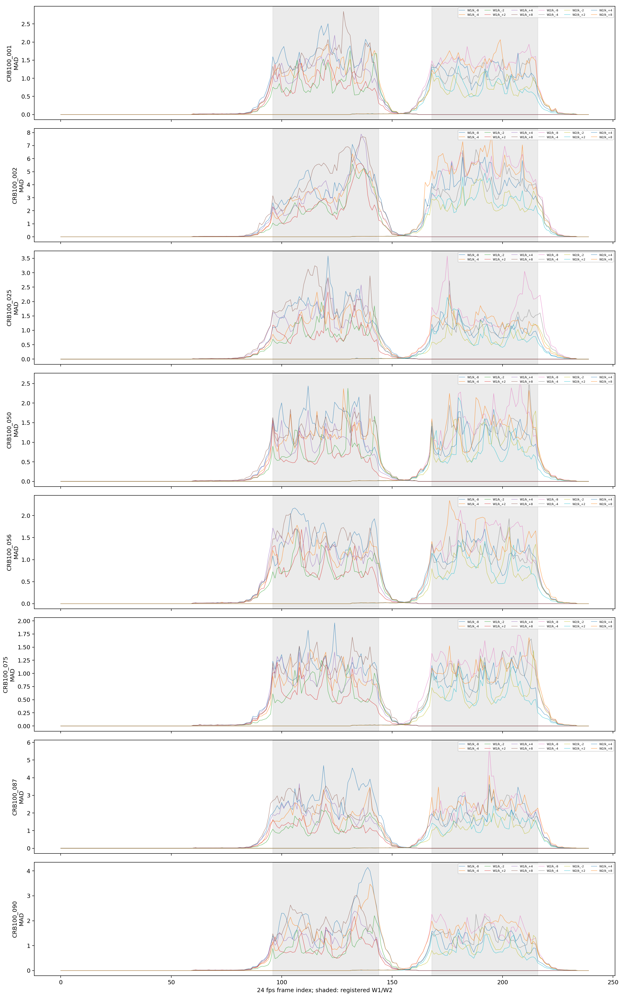

# Chain lip-offset（生成器内音频特征注入）

## 开工依据

口型评价器按登记判据未通过，事后诊断也未达到原定 6/7 门槛；负责人看过证据后决定开展本任务。

## 已登记矩阵与核验

8 人 × 15 条 = 120 条生成结果与 SyncNet 读数均存在（250 个 25fps 帧、20 个半秒段），均使用对应样本的原始 `audio.wav`。

| 检查 | 已登记结果 |
|---|---:|
| G1 clean 重复确定性 | 8/8 |
| G2 k=0 空动作 | 8/8 |
| G3 精确修复 | 8/8 |
| G5 | 96 条件通过、0 未通过 |
| G6 | 31 通过、1 未通过 |

### G4 主表（登记口径；已按任务书口径修正）

仅统计 |k| ∈ {4,8}（每人 2 窗口×4 条件）；无法判定者不计入分母。

| 人 | 状态 |
|---|---|
| CRB100_001（单列） | 通过 |
| 002 | 无法判定（W1 clean 低置信度） |
| 025 | 通过 |
| 050 | 未通过（W2,+8） |
| 056 | 通过 |
| 075 | 通过 |
| 087 | 无法判定（W1 clean 低置信度；W2 负方向不一致） |
| 090 | 通过 |

其余 7 人为 4 通过 / 5 可判定：可判定人数 ≥5，但未达到预登记的 6 人通过门槛。

### G4 附表（只报告；旧条件级口径）

把 ±2 也计入的旧统计原样保留：81 通过、3 未通过、12 无法判定；不替代登记口径主表。

## 逐人明细（登记结果）

每个窗口×k 的窗口内变化量、clean 置信度、期望值、误差、G4/G5 均完整写入 `analysis/report_completion_20261109.json` 的 `people.<sample>.details`。置信度门槛排除的段保留为空值/NaN；002、087 保留 `low_confidence_unit_test=true`。

## 失败、无法判定与事后读数审计

| 条件 | 分类 | 依据 |
|---|---|---|
| 050/W2/+8 | 评价器没测出来（待复核） | 四段变化量 9、9、−15、3；一段触及 SyncNet 搜索边界，段间不一致。 |
| 087/W2/−8、−4；G6 负方向 | 评价器没测出来（待复核） | 负方向窗口读数与预期符号/剂量不一致；保留失败。 |
| 002/W1、087/W1 | 无法判断 | clean 段置信度门槛排除，按登记规则不进入分母。 |

### clean 边界偏移（只报告、事后）

`confidence ≥3 且 |offset|≥10` 的逐项清单在 `posthoc_report_only_clean_boundary_offsets`；例如 075/W2 clean 偏移 15 可造成 −23 的相对变化。这不改变本轮 G4/G5/G6，仅供下一轮预先登记规则参考。

## 影响范围（只报告）

96 条编辑视频的统计（最小/中位数/最大）：非零差异首帧相对窗口起点均为 −36，末帧相对窗口终点均为 +18；差异 >0.5 的首帧为 −9/−3/0，末帧为 −4/+2/+9；窗口内峰值 1.135/2.194/7.911 RGB 值，距窗口 12 帧外峰值 0.020/0.034/0.107。

观察到的前 36、后 18 帧扩散与 ACC 12 帧上下文、3 帧重叠的多窗口渲染范围相符；相较手部姿态注入约 ±30 帧，本次更不对称。

## 副作用（只报告、事后）

8 条 clean_a 与 96 条编辑项的相对 clean_a 变化（中位数/最大绝对值）为：ArcFace 0.000/0.006，效价 +0.0005/0.040，happy 概率 0.000/0.033，姿态异常标记 0/8，闪烁标记 0/6，边界标记 0/5。逐人、窗口×k 数值在 `side_effects_report_only`；不用于 G1–G6 判定。跨 8 人的同口径 clean-repeat 波动范围并未完整提供，因此不标称任何变化“超过 clean-repeat 波动”。

## 生成版与真人原片口型对照（只报告）

逐人生成 clean 与真人 clean 的偏移/置信度中位数见 `generated_clean`、`human_clean`。生成版通常更接近 0，真人原片常见约 −2 至 −4 帧；仅描述现象，不作因果推断。

## 预览

16 条并排带原声预览为 8 人各 W1/+4、W1/−8：`docs/status/chain_lip_offset_media/CRB100_<id>_W1_k_{+4,-8}.mp4`。推荐先看 `CRB100_090_W1_k_-8.mp4` 和 `CRB100_025_W1_k_+4.mp4`。

## 可复核文件

- `analysis/lipsync_receipt.json`：原始登记 G4/G5/G6。
- `analysis/impact_and_summary.json`：逐帧像素差。
- `analysis/report_completion_20261109.json`：本次只读补齐汇总。
- `state_record_plan.json` / `state_record.json`：计划 / 回填实测。

结论：生成器接口、确定性和局部音频特征注入链路已直接验证；但按预登记整体 G4 门槛，当前评价链不足以宣称通过。
