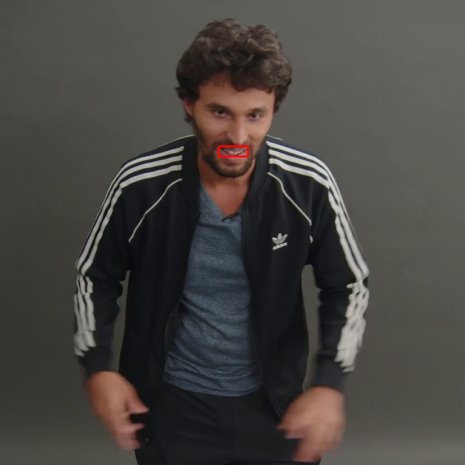

# Evaluator unit tests — pilot stop record (2026-11-08)

Status: **in progress; stopped after the required CRB100_001 × W1 pilot.**

The task requires A--C and preview inspection to pass before the other seven
people or W2 may start.  That gate was not met.  No thresholds, samples,
windows, evaluator references, or evaluator logic were changed to alter this
outcome.  No generator or training job was run.

## Exact pilot results

| Test | Result | Evidence |
|---|---|---|
| T1 Lip-sync | failed | All required offsets had the expected direction and were within one 25-fps frame, but exterior `|offset| <= 1` was 0.8571, below the pre-registered 0.90. |
| T2 Identity | passed for this pilot only | ArcFace window delta `-0.779776`; exterior delta `0.0`; DINO torso/hair window deltas `-0.3207/-0.463975`. |
| T3 Pose | failed | Freeze passed (coverage 1.0, no new frozen flag outside band); skip had no `motion_jump` in `a±2`; jump had a nearby flag but five new flags, above the allowed one. |
| T4 Temporal | failed | Mean flicker scores for 0.05/0.1/0.2 EV were 0.11062/0.13404/0.11148, not strictly monotonic; 0.1 EV flag fraction was 0.0.  Hard-cut boundary frames were 96 and 144, so the hard-cut subtest passed. |
| T5 Emotion | passed for this pilot only | Window means: correct 0.899689 > wrong 0.252315; pooled window AUC 1.0.  Targets are Meta automatic labels, not human ground truth. |
| T6 Hand | failed | Right-hand visibility window delta was `+0.130089`, not the required <= -0.30; exterior delta 0.0. |

T1 audio intervention validation: each W1 shift has an immutable
`audio_validation.json` sidecar.  The `k=+4` sidecar recovered `+2667` samples,
the registered rounded `4*16000/24`, and verified byte-identical exterior audio.

## Determinism (C)

Clean was run twice into separate `clean_repeats/CRB100_001/repeat{1,2}`
directories.  All seven NPZ evaluator outputs were elementwise equal with NaNs
treated as equal.  Two JSON files differed only in timing metadata:
`run_meta.json` wall-clock fields and temporal evidence's `seconds`; no score
array differed.

## Stop decision

The failed items are evaluator/test response failures (category A unless later
pixel evidence contradicts it), not grounds to retune thresholds.  Per the
task's D gate, the remaining seven people, W2, preview media, and full decision
table were not started.

## RAVDESS

`scripts/evaluators/ravdess_face_check.py` and historical evidence were found,
but no RAVDESS raw-video root was found under `/data/lanyi`; it was not rerun and
no new data was downloaded.  The historical status document records AUC 0.9253.

## Artifact root

`/data/lanyi/outputs/cfpr-v2/evaluator_unit_tests_20261108/`

This root contains raw outputs, edit metadata, pilot log, and
`clean_determinism_check.json`; none are included in the repository.

## Revision 2 protocol — implementation stage (in progress)

The preceding sections are the immutable first-version CRB100_001 × W1 pilot record.
They are retained verbatim. Revision 2 uses the same eight samples and registered
windows, with the revised standards fixed in
`docs/tasks/2026-11-08_evaluator_unit_tests_v2.md` before any of the seven new
people are run. Its raw outputs are written to
`/data/lanyi/outputs/cfpr-v2/evaluator_unit_tests_20261108_v2/`, rather than
replacing the first-version artifact root.

### C1 hand-side verification before v2 execution

DWPose order is fixed as `hands[0] = person-left`, `hands[1] = person-right`.
Three independent pieces of evidence were recorded on CRB100_001 frame 0:

| Evidence | DWPose index 0 | DWPose index 1 |
|---|---:|---:|
| COCO-WholeBody left hand (91–111), mean aligned distance | 16.07 px | 55.32 px |
| COCO-WholeBody right hand (112–132), mean aligned distance | 60.76 px | 13.65 px |
| WiLoR false/left vs true/right best-box IoU | 0.858 / 0.334 | 0.465 / 0.792 |

The source COCO keypoint convention is left `91:112`, right `112:133`; the
raw source is named in `prepared_inputs_aligned_v1/CRB100_001/input_manifest.json`.
The manually inspectable annotated frame is
`evaluator_unit_tests_20261108_v2/preflight/CRB100_001_frame000_dwp_hands.png`.
Accordingly, all v2 T6 occlusions use index 1 and expected left/right boxes
are generated from clean DWPose only.

### Implemented v2 corrections and pre-run tests

- C2: windowed audio shifts now fill the vacated samples from adjacent real
  audio, never silence; outside-window samples remain byte-identical.
- C3/C4/C5/C6/C7: skip uses the fixed 12-frame mapping; jump accepts
  `motion_jump` or `jerk` and excludes its registered event band; T1 compares
  exterior offsets against the same clean segments; T4a uses `flicker_level`,
  T4b is a registered one-frame exposure test, and T4c requires both
  boundaries while asserting 239 pair records.
- T6 adds an expected-hand mode without changing legacy output fields:
  side-consistent IoU >= 0.3 association, expected-but-unmatched visibility
  0 and missingness 1, and NaN for hands not expected in a frame.
- Fresh focused test evidence before the pilot: `21 passed` from
  `tests/test_evaluator_unit_edits.py`,
  `tests/test_hand_visibility_expected.py`, and
  `tests/test_evaluator_unit_analysis_v2.py`.

The v2 CRB100_001 W1 queue is running at the time of this update. No
threshold, sample, window, reference file, evaluator weight, generator, or
training configuration has been changed.

### Revision 2 CRB100_001 × W1 pilot

All 20 registered conditions completed. Edit self-check: 20/20 passed. Clean
repeat5/repeat6 produced elementwise-equal (NaN-aware) arrays for DWPose,
ArcFace, SyncNet, pose, temporal evidence/context, and expected-hand WiLoR.
The actual pilot decisions are T1 pass, T2 pass, T3 freeze pass, T3 jump pass
(skip is report-only), T4a/T4b/T4c pass, T5 pass, and T6 fail. T6's expected
right-hand visibility fell by -0.8219 and missing-right fraction was 0.9792,
but left-hand visibility also fell by -0.4571 (required absolute change <=0.10).
This is retained as a control-isolation failure, not repaired by changing a
threshold, sample, or window. Preview assets are audit-only and listed in the
publication manifest; their pixels are never evaluator inputs.

### Revision 2 pilot audit, reproducibility, and publication preparation

This subsection supersedes the implementation-stage sentence that called the
queue “running”; the completed pilot result above is authoritative. The
pre-registered v2 decision logic was fixed before any unseen person was
started. No threshold, sample, window, model, or evaluator reference was
changed after observing this result.

- **T1:** every registered offset had relative exterior agreement 1.0 and the
  required direction/delta.
- **T2:** ArcFace target-window delta was -0.779776 and exterior delta was
  0.0.
- **T3:** freeze coverage was 1.0 with no exterior new frozen flag; the jump
  evidence lay near the registered event and was exterior-clean. The
  registered skip condition is reported but does not enter the v2 pass count.
- **T4:** flicker-level means were 0.032202, 0.047016, and 0.100055 for
  0.05/0.10/0.20 EV; the one-frame condition triggered; the hard-cut
  boundaries were 96 and 144 and all 239 adjacent-pair records were present.
- **T5:** correct/wrong means were 0.899689/0.252315; pooled AUC was 1.0.
- **T6:** right visibility delta was -0.821909 and right missing fraction
  0.979167, but left visibility delta was -0.457066. The required
  non-target isolation condition (absolute left change <= 0.10) therefore
  fails. This failure remains a result, rather than a basis to alter the
  intervention or threshold.

The clean determinism retries repeat1--repeat4 are retained in the private
artifact root as failed setup attempts: repeat1/2 targeted a nonexistent clean
emotion target; repeat3/4 omitted the loaded configuration in the repeat
path. They produced no accepted result. With those execution bugs fixed,
repeat5/repeat6 completed and `clean_determinism_check_v2.json` records
NaN-aware elementwise equality for every numeric evaluator output and exact
equality for identifiers.

The pilot generated 20 paired audit previews (40 files): an MP4 comparison and
a PNG contact sheet for each registered condition. They are derived only after
evaluation and are never evaluator inputs. The released copies were size-audited:
every MP4 is below 3 MB, every PNG is below 500 KB, and their total is
6,391,621 bytes. The assets contain the approved public preview frames only;
no arrays, audio, checkpoints, raw datasets, credentials, or full-resolution
source material are included.
### Output immutability guard before full matrix

Before expanding to W2 and the remaining seven people, preparation was hardened
so that a registered condition directory is created exactly once. `--window`
now selects an explicit registered subset, and any pre-existing condition
directory raises `FileExistsError` instead of being reused or overwritten.
This permits CRB100_001 W2 to be prepared without touching its completed W1
artifacts. The protection is covered by the focused test
`test_prepare_window_selection_and_fresh_directory_guard`; the full focused
suite passed (25 tests).The same refusal guard now applies to every evaluator output directory (clean,
condition, and determinism-repeat modes), so a retry cannot replace raw
readings already written under an existing artifact path.
### T6 v2.1 pre-analysis registration

Supplement `2026-11-08_evaluator_unit_tests_v2_1_T6.md` was registered in b507
commit `ad00e9f` before any T6 numeric result for the other seven people was
opened, computed, or aggregated. At registration time only result-file names
were listed to observe queue status; no T6 arrays, JSON metrics, or summary
values for those seven people were inspected. v2.1 changes only the geometric
left-hand isolation check; original v2 T6 is retained for parallel reporting.
## Revision 2.1 final matrix result (T6 left-hand overlap rule)
All full-matrix condition evaluations are complete. One report-only condition, CRB100_001/W2 T3 skip, was interrupted by the preserved GPU1 queue-parameter incident; it is not a v2 pass criterion and is not represented as a successful result.
### Fixed v2 decisions — other seven people
| Item | Passed people | Threshold | Result |
|---|---:|---:|---|
| T1 | 0/7 | 6/7 | fail |
| T2 | 7/7 | 6/7 | pass |
| T3 freeze | 7/7 | 6/7 | pass |
| T3 jump | 3/7 | 6/7 | fail |
| T4a | 7/7 | 6/7 | pass |
| T4b | 6/7 | 6/7 | pass |
| T4c | 5/7 | 6/7 | fail |
| T5 | 3/7 | 6/7 | fail |
| T6 v2 | 2/7 | 6/7 | fail |
| T6 v2.1 | 7/7 | 6/7 | pass |

### T6 v2 and v2.1 side-by-side
v2.1 was committed before any other-seven T6 numeric output was opened, computed, or aggregated. At that time only result-file names were listed for queue observation. v2.1 uses only occlusion-box/clean-left-box geometry; no evaluator score selects overlap frames.

| Sample | Window | v2 | Applied | Overlap | Non-overlap left eligible | v2.1 left check | v2.1 |
|---|---|---|---:|---:|---:|---|---|
| CRB100_001 | W1 | fail | 48 | 41 | 7 | undetermined | pass |
| CRB100_001 | W2 | fail | 48 | 48 | 0 | undetermined | pass |
| CRB100_002 | W1 | fail | 48 | 20 | 28 | passed | pass |
| CRB100_002 | W2 | fail | 48 | 48 | 0 | undetermined | pass |
| CRB100_025 | W1 | pass | 48 | 0 | 48 | passed | pass |
| CRB100_025 | W2 | fail | 48 | 33 | 15 | passed | pass |
| CRB100_050 | W1 | fail | 48 | 37 | 11 | undetermined | pass |
| CRB100_050 | W2 | pass | 48 | 0 | 48 | passed | pass |
| CRB100_056 | W1 | pass | 48 | 10 | 38 | passed | pass |
| CRB100_056 | W2 | pass | 48 | 0 | 48 | passed | pass |
| CRB100_075 | W1 | pass | 48 | 0 | 48 | passed | pass |
| CRB100_075 | W2 | pass | 48 | 4 | 44 | passed | pass |
| CRB100_087 | W1 | pass | 48 | 4 | 30 | passed | pass |
| CRB100_087 | W2 | fail | 48 | 40 | 6 | undetermined | pass |
| CRB100_090 | W1 | fail | 48 | 48 | 0 | undetermined | pass |
| CRB100_090 | W2 | pass | 48 | 0 | 48 | passed | pass |

Under the original v2 T6 rule, only 2/7 unseen people pass both windows, so T6 v2 fails. Under registered v2.1, all 7/7 unseen people pass both windows, so T6 v2.1 passes. The two conclusions are reported in parallel.

Private raw artifact root: `/data/lanyi/outputs/cfpr-v2/evaluator_unit_tests_20261108_v2/`; public JSON summary is `docs/status/evaluator_unit_tests_20261108_summary_v21_final.json`.

## 漏项补跑与系统核查（事后）
本节为看过全量结果后的事后诊断；不修改第二版或 v2.1 登记结论。
核查：320 条条件中标准目录完整 319 条，retry 完整 1 条，缺失 0 条。
CRB100_087/W1/T4 instant_ev_0.2 原队列脚本列出但静默未执行，目标目录从未创建；此前汇报只数现有 run_meta、未做笛卡尔积核查，故漏列。补跑后 T4b 从“补跑前 6/7（缺 1 条）”变为事后重算 7/7；这不改写原登记表。CRB100_001/W2 T3/skip 在独立 evaluators_posthoc_retry_v1 完成，且 skip 一直仅报告。

## 事后诊断（看过结果后进行，仅供参考）

### D1 事后：相对 clean 口型
| 置信度阈值 | 其余 7 人两个窗口相对准确 |
|---:|---:|
| 2 | 3/7 |
| 3 | 3/7 |
| 4 | 3/7 |
门槛 2/3/4 结论稳定为 3/7；SyncNet 置信度不再作为“必须下降”的判据。

> 已被修正版取代，见下方 D1′。原表和原始 `posthoc_diagnosis_20261109.json` 保留，仅供追溯。

### D2 事后：口型基线来源
| 样本 | mouth-audio lag | SyncNet 中位数 | 结论 |
|---|---:|---:|---|
| CRB100_001 | -5 | -1.0 | inconsistent_more_likely_syncnet_bias |
| CRB100_002 | 2 | -3.0 | inconsistent_more_likely_syncnet_bias |
| CRB100_025 | -4 | -4.0 | consistent_more_likely_data_offset |
| CRB100_050 | 10 | 0.0 | inconsistent_more_likely_syncnet_bias |
| CRB100_056 | -9 | 0.0 | inconsistent_more_likely_syncnet_bias |
| CRB100_075 | 10 | -1.0 | inconsistent_more_likely_syncnet_bias |
| CRB100_087 | 10 | -2.0 | inconsistent_more_likely_syncnet_bias |
| CRB100_090 | -10 | -2.0 | inconsistent_more_likely_syncnet_bias |
相关系数整体较低，D2 只能提示而不能确证偏移来源。

> 已被修正版取代，见下方 D2′。原表和原始 `posthoc_diagnosis_20261109.json` 保留，仅供追溯。

### D3 事后：突跳扩展事件窗
| 样本 | 窗口 | a±5 检出 | 窗口外新增 | a/a+30 手有效点 | 位移(肩宽) |
|---|---|---|---:|---|---:|
| CRB100_001 | W1 | True | 0 | 42/42 | 0.387 |
| CRB100_001 | W2 | False | 0 | 42/42 | 0.026 |
| CRB100_002 | W1 | True | 0 | 42/42 | 0.319 |
| CRB100_002 | W2 | True | 0 | 42/41 | 0.281 |
| CRB100_025 | W1 | True | 0 | 42/42 | 0.157 |
| CRB100_025 | W2 | True | 0 | 42/42 | 0.055 |
| CRB100_050 | W1 | True | 0 | 42/42 | 0.214 |
| CRB100_050 | W2 | True | 0 | 42/42 | 0.220 |
| CRB100_056 | W1 | True | 0 | 42/42 | 1.716 |
| CRB100_056 | W2 | True | 0 | 42/42 | 0.688 |
| CRB100_075 | W1 | False | 0 | 42/42 | 0.057 |
| CRB100_075 | W2 | True | 0 | 42/42 | 0.150 |
| CRB100_087 | W1 | True | 0 | 42/21 | 1.369 |
| CRB100_087 | W2 | True | 0 | 24/42 | 1.180 |
| CRB100_090 | W1 | True | 0 | 42/42 | 0.372 |
| CRB100_090 | W2 | True | 0 | 42/42 | 0.077 |

### D4 事后：硬切像素差
| 样本 | 窗口 | a edit/clean | b edit/clean | clean p99 |
|---|---|---:|---:|---:|
| CRB100_001 | W1 | 8.06/0.75 | 6.56/0.87 | 5.51 |
| CRB100_001 | W2 | 4.52/0.85 | 4.36/1.45 | 5.51 |
| CRB100_002 | W1 | 21.82/7.16 | 23.02/8.41 | 13.33 |
| CRB100_002 | W2 | 15.26/12.54 | 23.93/10.64 | 13.33 |
| CRB100_025 | W1 | 12.82/0.55 | 13.85/1.61 | 4.01 |
| CRB100_025 | W2 | 7.62/0.92 | 6.46/0.35 | 4.01 |
| CRB100_050 | W1 | 7.27/2.23 | 8.73/2.07 | 3.16 |
| CRB100_050 | W2 | 7.24/2.11 | 9.71/1.98 | 3.16 |
| CRB100_056 | W1 | 8.41/2.47 | 13.46/4.40 | 6.97 |
| CRB100_056 | W2 | 13.47/3.73 | 8.94/1.42 | 6.97 |
| CRB100_075 | W1 | 5.82/1.10 | 5.63/0.45 | 5.00 |
| CRB100_075 | W2 | 6.66/1.12 | 7.26/1.37 | 5.00 |
| CRB100_087 | W1 | 18.99/8.52 | 21.37/3.22 | 14.62 |
| CRB100_087 | W2 | 18.48/4.75 | 25.43/11.67 | 14.62 |
| CRB100_090 | W1 | 23.69/1.49 | 9.89/0.99 | 5.60 |
| CRB100_090 | W2 | 11.71/1.24 | 14.35/0.51 | 5.60 |

### D5 事后：标签缺失与判错
有效段合并 AUC（仅有效段）=0.834。
| 样本 | 窗口 | 有效段 | 标签缺失 | correct≤wrong |
|---|---|---:|---|---|
| CRB100_001 | W1 | 4 | False | False |
| CRB100_001 | W2 | 4 | False | False |
| CRB100_002 | W1 | 4 | False | False |
| CRB100_002 | W2 | 4 | False | True |
| CRB100_025 | W1 | 4 | False | False |
| CRB100_025 | W2 | 4 | False | False |
| CRB100_050 | W1 | 4 | False | False |
| CRB100_050 | W2 | 4 | False | False |
| CRB100_056 | W1 | 0 | True | False |
| CRB100_056 | W2 | 0 | True | False |
| CRB100_075 | W1 | 4 | False | True |
| CRB100_075 | W2 | 4 | False | False |
| CRB100_087 | W1 | 1 | False | False |
| CRB100_087 | W2 | 0 | True | False |
| CRB100_090 | W1 | 4 | False | False |
| CRB100_090 | W2 | 4 | False | False |

## 事后诊断修正（D1′、D2′、D6、CRB100_087；看过结果后进行，仅供参考）

以下结果写入新的 `posthoc_diagnosis_fix_20261109.json`；不覆盖旧 JSON，也不改变第二版或 v2/v2.1 的登记结论。D2′ 在生成任何结论前，先将同一音频包络人为推后 5 个 24 fps 帧：检测滞后由 0 变为 +5。这里的正号表示音频相对嘴部推后；按 T1 已登记关系，SyncNet 读数对应变化为 `-k × 25/24`，故口型/音频滞后先乘 `25/24` 再取相反号后才与 SyncNet 比较。

### D1′ 事后：无法判定单列的相对 clean 口型

| clean 置信度门槛 | 其余 7 人准确 | 可判定 | 无法判定 | 可判定人数≥5 |
|---:|---:|---:|---|---|
| 2 | 3 | 7 | 无 | 是 |
| 3 | 3 | 7 | 无 | 是 |
| 4 | 3 | 6 | CRB100_087 | 是 |

门槛 3 下，|k|=4、8 的个人判定为“两个窗口均准确 / 任一窗口不准 / 其余无法判定”；故为 **准确 3 / 可判定 7**。这修正的是分母和“无法判定”的处理，并不把 087 在门槛 3 的实际不准窗口改作无法判定。

| |k|（24 fps） | 可判定窗口×方向 | 相对准确 | 方向正确 |
|---:|---:|---:|---:|
| 2（只报告） | 26 | 23/26（88.5%） | 26/26（100.0%） |
| 4 | 26 | 22/26（84.6%） | 26/26（100.0%） |
| 8 | 26 | 21/26（80.8%） | 25/26（96.2%） |

### D2′ 事后：经符号、单位和可判定条件校准的口型基线来源

张嘴幅度使用内唇 (61,67)、(62,66)、(63,65) 三对的平均距离，并以两眼外角 (36,45) 归一化；任一所需点 `face_score < 0.3` 的帧保留为 NaN。音频先 300–3000 Hz 带通，再按 24 fps RMS、双方三帧平滑和去均值互相关。仅当相关峰值≥0.3 且最佳滞后不在 ±10 搜索边界时比较。

| 样本 | mouth/audio lag（24 fps，正=音频后移） | 峰相关 | 换算后的 SyncNet 同号值（25 fps） | SyncNet 全局读数 | D2′ 事后结论 |
|---|---:|---:|---:|---:|---|
| CRB100_001 | 2 | 0.206 | -2.08 | -1 | 无法判断 |
| CRB100_002 | -2 | 0.329 | 2.08 | -3 | 不一致→更可能是 SyncNet 偏差 |
| CRB100_025 | 3 | 0.435 | -3.12 | -4 | 一致→更可能是数据本身不同步 |
| CRB100_050 | -10 | 0.252 | 10.42 | 0 | 无法判断 |
| CRB100_056 | 9 | 0.024 | -9.38 | 0 | 无法判断 |
| CRB100_075 | -10 | 0.033 | 10.42 | -1 | 无法判断 |
| CRB100_087 | -9 | 0.379 | 9.38 | -1 | 不一致→更可能是 SyncNet 偏差 |
| CRB100_090 | 10 | 0.270 | -10.42 | -2 | 无法判断 |

计数：一致 1， 不一致 2，无法判断 5。相关曲线与峰值、SyncNet 标记见 `evaluator_unit_tests_20261108_media/posthoc_diagnosis_fix_20261109/d2_*.png`。

### D6 事后：|k|=8 的少读排查

诊断直接复用 `eval_lipsync.py` 已保存的 `gen_lipsync.npz` 距离曲线；在作图和分析前，所有涉及 clean/edited 文件的全局及 0.5 秒段最佳偏移、置信度均与原 `gen_lipsync.json` 一致。每个案例的 20 段 clean/edited“距离 vs 偏移”曲线、预期位置和逐段数值均在新 JSON 与对应 PNG 中保存。窗口音量包络自相关的首个最大候选周期均为 2 个 25 fps 帧。

| 样本 | 窗口 | k（24 fps） | 预期相对变化（25 fps） | 自相关候选周期（25 fps） | D6 事后结论 |
|---|---|---:|---:|---:|---|
| CRB100_025 | W1 | +8 | -8.33 | 2 | 其他 / 无法判断 |
| CRB100_025 | W2 | +8 | -8.33 | 2 | 其他 / 无法判断 |
| CRB100_050 | W2 | -8 | +8.33 | 2 | 其他 / 无法判断 |
| CRB100_002 | W1 | +8 | -8.33 | 2 | 其他 / 无法判断 |
| CRB100_090（对照） | W1 | -8 | +8.33 | 2 | 其他 / 无法判断 |
| CRB100_090（对照） | W1 | +8 | -8.33 | 2 | 其他 / 无法判断 |

曲线中未得到可复现的“第二峰位置—2 帧自相关候选周期—少读读数”对应关系，因此不把音节混淆猜测确认为结论，也不将“预期位置平坦”作为证据不足时的替代性判定。

### CRB100_087 事后单列：clean SyncNet 置信度与嘴部截图

| 样本 | clean 段置信度中位数 | 最小 | 最大 |
|---|---:|---:|---:|
| CRB100_001 | 7.019 | 3.342 | 10.336 |
| CRB100_002 | 4.027 | 0.399 | 10.169 |
| CRB100_025 | 7.930 | 2.460 | 12.770 |
| CRB100_050 | 5.420 | 1.705 | 10.233 |
| CRB100_056 | 5.506 | 3.152 | 10.100 |
| CRB100_075 | 5.353 | 1.035 | 8.195 |
| CRB100_087 | 2.181 | 0.384 | 7.692 |
| CRB100_090 | 5.832 | 1.370 | 11.773 |

三张截图标出了嘴部关键点包围盒；帧 96/120/192 的所需关键点最小 `face_score` 分别为 0.960/0.972/0.958（均≥0.3）。本单列只报告这些数值和图像，不据此归因或改写 D1′/D2′。

## 评价器使用建议（事后）
| 评价器 | 建议 | 条件 |
|---|---|---|
| Lip-sync | 有条件地用 | 仅 clean 段置信度≥3、每条件≥2 有效段；正式扰动范围为 |k|=4、8，|k|=2 只报告。门槛 3 下其余 7 人个人准确 3/7；方向正确率为 |k|=4: 26/26、|k|=8: 25/26，高于大小准确率（22/26、21/26），故方向与大小分开报告，不能单独作硬门槛。 |
| Identity | 可以直接用 | T2 7/7。 |
| Pose freeze | 可以直接用 | T3 freeze 7/7。 |
| Pose jump | 有条件地用 | 需结合 a±5、手可见性和位移；登记检出仅 3/7。 |
| Temporal flicker | 有条件地用 | T4a/T4b 的事后诊断证据可供条件性使用；硬切需先量化两侧画面差。 |
| Emotion | 有条件地用 | 仅有效标签段；标签缺失与判错分开。 |
| Hand T6 | 有条件地用 | 同时报 v2/v2.1；交叠帧用几何排除。 |
